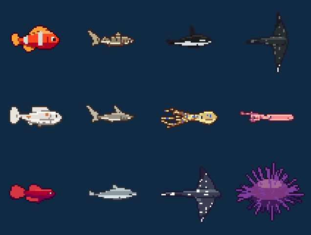
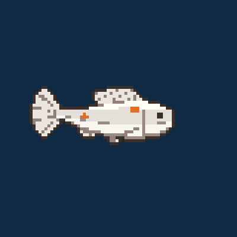
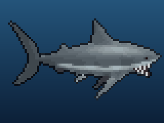
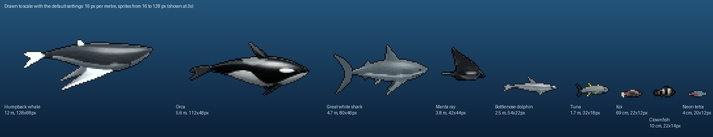
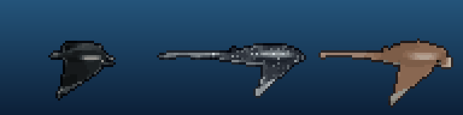
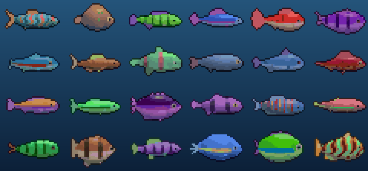
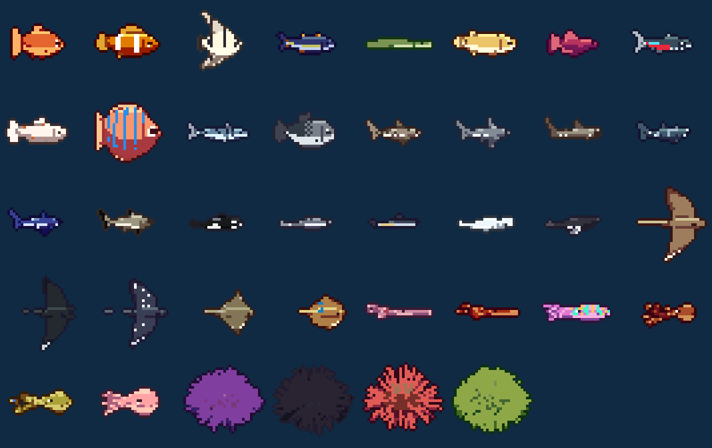
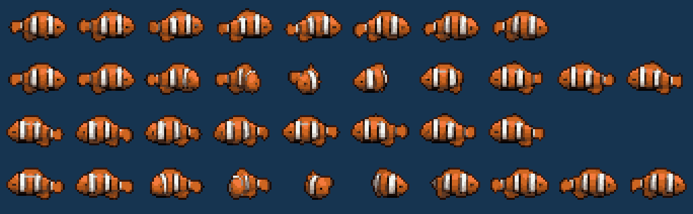

<div align="center">

# 🐟 fishgen

**Procedural pixel-art sea creatures, rendered from realistic 3D models, with game-ready swim and turn-around animations.**

[](https://www.python.org/)
[](LICENSE)
[](#playing-it-in-a-game)




</div>

Every seed gives a different fish (body shape, fins, tail, colours and pattern) with four
animations that hand off seamlessly into each other. Besides fish it makes sharks, whales
and dolphins, rays, squid and octopus, and sea urchins. Each one is modelled and lit in 3D
like the real animal - sun through the water, soft shadows, wet sheen, silver flanks,
translucent fins, real markings and eyes - and then turned into **pixel art**: any size from
16x16 to 128x128 (or whatever you like), one small palette per sprite, crisp edges and a
selective outline. Ask for a species and a size and you get an N x N sprite of it; if you want
a scene where a clownfish is a speck next to a humpback, `--to-scale` draws them to one scale.
Export as GIFs, a sprite sheet + JSON, loose PNG frames, or a Godot 4 `SpriteFrames` resource.

```sh
fishgen sprite "neon tetra" 32      # -> out/neon_tetra_32px_<seed>/  (sheet + JSON + GIFs)
```

- 🎲 **Infinite variety** - same seed, same fish; a new seed, a new fish
- 🦈 **7 kinds, 47 species presets** - from neon tetras to whale sharks, mantas and octopus,
  many in several colour varieties (Kohaku / Sanke / Showa / Ogon koi, black mantas, betta colours...)
- 👾 **Pixel art, any size** - 16, 24, 32, 48, 64, 96, 128 px or a custom canvas; palette size and outline are up to you
- 📏 **To scale when you want it** - every animal has its real length; `--to-scale` draws them to one scale
- 🔄 **Seamless 3/4 turn-arounds** - the fish shows its face mid-turn, no sprite flipping
- 🖌️ **Designer GUI** - tweak every gene and watch it re-render live
- 🎮 **Game-ready exports** - sprite sheets with metadata and drop-in Godot 4 resources

<table>
<tr>
<td align="center"><br><sub>one koi, full cycle</sub></td>
<td align="center"><br><sub>a great white turning around</sub></td>
</tr>
</table>

```
swim_right ──▶ turn_right_to_left ──▶ swim_left ──▶ turn_left_to_right ──▶ swim_right
   ↻ loop                                ↻ loop
```

The turn is a 3/4 rotation: the fish swings its head towards the viewer, shows its face,
and comes out facing the other way, with its body curving behind its head.

Pufferfish get two more, `puff_right` and `puff_left`: the slim little fish swells into a
spiky ball, holds it, and deflates back into its swim (both hand back to the matching swim loop).

**Pixel art from 3D.** Every frame is first rendered as a detailed, anti-aliased image of the
3D animal, then made into pixel art: an edge-preserving blur irons out texture that would only
become noise, one palette for all of the sprite's frames is picked by k-means in the
perceptual OKLab colour space (10 colours at 16 px up to 24 at 128 px; `--colors N` to
choose), edges are made hard, lone stray pixels are merged away, small eyes get a clear pupil
pixel, and a selective outline - a dark shade of whatever colour it borders - goes round the
silhouette (`--no-outline` to drop it). `--style smooth` keeps the full-colour renders instead.

**Sizes.** Every sprite is 32x32 unless you say otherwise: `--size 16` (or `64`, `96`, `128`,
`48x32`...) fits the animal into that canvas. With `--to-scale`, animals are drawn **to scale**
instead: each carries its real adult length
(`length_cm`, varying from one individual to the next; rays are measured across the wings,
urchins across the shell) at `--px-per-m` pixels to the metre - 16 by default, so a 4.7 m
great white is about 75 px long. Small fish are still drawn at least `--min-px` (16) long, and
the biggest whales are shrunk to fit a `--max-px` (128) sprite, and each canvas is just big
enough for its animal.



**Rays** are seen from the side like everything else: the body heaves as the wings beat up and
down past it, the wingtips trail the stroke, and a rising near wing turns its pale underside to
you, just as in photos of a manta gliding by.



## Gallery

**24 random fish** (`fishgen generate --count 24`): no two alike.



**Every species preset**, seed 1, each fitted to a 48x32 sprite and shown at 3x (row by row: fish, sharks, whales & dolphins, rays, squid & cuttlefish, octopus, urchins):



## Quick start: the designer window

```sh
git clone https://github.com/JacobKulberg/fish-gen.git
cd fish-gen
py gui.py          # Windows   (python3 gui.py elsewhere)
```

That's it. The first run creates `.venv` and installs numpy + Pillow by itself.

Pick a **kind** of animal first, then a **species** of that kind (or *Random* for a random
animal of that kind), then tweak anything on the tabs - body shape, eye, fins, wings and arms,
colours and pattern, skin (silver sheen, gloss, scales, scars), length, frame counts, and on
the *Sprite* tab pixel art or smooth, palette size, outline, and a fixed canvas or to scale.
The sprite size (16 to 128 px, 32 by default) is picked with one click right under the species. Species with colour varieties get a *Variety* box. Only the controls that apply to the chosen
kind are shown. The animal re-renders live on the right.

The kind is always decided first and every gene is then drawn to suit it, so a random shark
is always a shark (shark tail, gill slits, two dorsal fins, stiff side fins) and only its
proportions, snout, colours and markings vary; a random ray is always a flat winged ray, and so on.
Presets work the same way: the species fixes what makes it that species (a Tiger shark's
stripes, an Orca's markings) and each seed is a different individual of it, with its own
build, fin, wing or arm sizes, shading and the odd scar.

| kind | species |
|---|---|
| Fish | Random (with a chosen body type), Goldfish, Clownfish, Angelfish, Tuna, Eel, Pufferfish, Betta, Neon tetra, Koi, Discus, Mackerel, Piranha, Yellow tang, Blue tang, Rainbow trout, Atlantic salmon, Great barracuda, Ocean sunfish |
| Shark | Tiger shark, Great white shark, Hammerhead shark, Whale shark, Mako shark, Blacktip reef shark, Blue shark, Nurse shark |
| Whale & dolphin | Orca, Bottlenose dolphin, Common dolphin, Beluga, Humpback whale, Sperm whale |
| Ray | Cownose ray, Manta ray, Spotted eagle ray, Stingray, Bluespotted stingray |
| Squid & cuttlefish | Squid, Giant squid, Cuttlefish |
| Octopus | Octopus, Blue-ringed octopus, Dumbo octopus |
| Sea urchin | Purple sea urchin, Long-spined urchin, Red pencil urchin, Green sea urchin |

Colour varieties (picked by the seed, or with `--morph`): Goldfish (Orange, Red and white,
Calico, Lemon), Clownfish (Ocellaris, Black), Angelfish (Silver, Marble, Black), Betta (Red,
Royal blue, Black orchid, Koi, Pastel), Koi (Kohaku, Taisho Sanke, Showa, Ogon, Chagoi),
Discus (Red turquoise, Blue diamond, Pigeon blood), Manta ray (Chevron, Black), Cuttlefish
(Rose, Zebra). Orcas are male (tall straight fin, bigger) or female (curved fin).

Each animal moves its own way: whales and dolphins beat their flukes up and down, rays flap
(or ripple) their wings past the body, squid and octopus jet mantle-first
with their arms trailing and flaring, and urchins sit still while their spines sway. The **Export** tab writes the same files as `fishgen generate`
(named after the species and seed, e.g. `out/koi_5/koi_5.png`).

## Install (command line)

```sh
python -m venv .venv
.venv/Scripts/activate            # Windows  (source .venv/bin/activate elsewhere)
pip install -e ".[preview,dev]"
```

## Usage

```sh
fishgen                                         # opens the designer window
fishgen sprite clownfish                        # a 32x32 clownfish: sheet + JSON + GIFs
fishgen sprite "neon tetra" 64                  # a 64x64 neon tetra (case, spaces, hyphens don't matter)
fishgen sprite great-white 128x64 --seed 3      # any WxH, a particular individual
fishgen generate --seed 42                      # a random fish, all formats into ./out/fish_32px_42/
fishgen generate --species Clownfish --count 5  # five different clownfish
fishgen generate --species "Tiger shark" --to-scale   # to scale: ~70px long
fishgen generate --species Koi --morph Showa    # pick the colour variety
fishgen generate --species Pufferfish           # includes the puff-up animations
fishgen generate --kind ray --count 4           # four random rays: ./out/ray_<seed>/
fishgen generate --kind whale --size 96         # fitted to a 96x96 sprite
fishgen generate --count 20 --size 16 --out fish    # 20 fish, each a 16x16 sprite
fishgen generate --seed 3 --size 64 --colors 8 --no-outline
fishgen generate --species Orca --style smooth --to-scale --px-per-m 100 --max-px 1600  # full colour, 1px per cm
fishgen generate --seed 7 --size 128x64 --formats sheet,godot
fishgen generate --seed 7 --formats gif --scale 2 --bg "#1d3557"
fishgen preview --fish 5 --to-scale             # live aquarium window, to scale
```

`python -m fishgen ...` works too. `fishgen sprite SPECIES [SIZE]` takes every option below
and writes the sprite sheet, JSON and GIFs (`--formats all` for the rest).

### Options

| option | default | |
|---|---|---|
| `--seed N` | random | same seed = same fish |
| `--kind KIND` | fish | `fish`, `shark`, `whale`, `ray`, `squid`, `octopus` or `urchin`: a random animal of that kind |
| `--species NAME` | random | preset (implies its kind; also works with `preview` and `gui`); case, spaces and hyphens don't matter, and a unique part is enough (`hammer`) |
| `--morph NAME` | from the seed | colour variety of the `--species` |
| `--size N` or `WxH` | `32` | fit the animal into this canvas (16, 32, 64, 96, 128, 48x32...) |
| `--to-scale` | | draw animals to scale with each other instead of a fixed canvas |
| `--px-per-m PX` | `16` | to scale: pixels per metre of animal |
| `--min-px` / `--max-px` | `16` / `128` | to scale: small animals are drawn at least this long; the biggest are shrunk to fit a sprite this big |
| `--style` | `pixel` | `pixel` art or `smooth` anti-aliased full-colour renders |
| `--colors N` | auto | pixel art: palette size (10 at 16 px up to 24 at 128 px) |
| `--no-outline` | | pixel art: leave out the dark outline |
| `--swim-frames` | `8` | frames per swim cycle |
| `--turn-frames` | `10` | frames per turn-around |
| `--fps` | `10` | playback rate written into every format |
| `--pitch` | `0.25` | camera tilt (radians); higher shows more of the back |
| `--formats` | all | any of `gif,sheet,godot,frames` |
| `--count` | `1` | batch: consecutive seeds, one folder each |
| `--scale` | `4` | GIF upscale factor (nearest-neighbour, so pixels stay crisp) |
| `--frame-scale` | `1` | upscale for loose PNG frames |
| `--bg #RRGGBB` | transparent | opaque GIF background |
| `--padding` | `0` | gap between sprite-sheet cells |
| `--godot-dir` | `res://` | folder the `.tres` expects the PNG in |

### Preview keys

`SPACE` new fish · `←/→` previous/next seed · `T` turn · `G` show all animation frames ·
`P` pause · `+/-` zoom · `E` export the fish on screen · `ESC` quit

## Output



```
out/fish_32px_42/
  fish_32px_42.png     sprite sheet: one row per animation
  fish_32px_42.json    frame rects, fps, loop flags, `next` animation, length, scale, palette, genome
  fish_32px_42.tres    Godot 4 SpriteFrames (uses fish_32px_42.png)
  gif/                 one GIF per animation + showcase.gif (the whole cycle)
  frames/<anim>/       individual PNG frames
```

All frames of one animal share the same canvas and the animal is always centred, so the
sprite's pivot is the middle of the frame (`meta.pivot` in the JSON). With `--to-scale`
canvas sizes differ between animals; either way `meta.length_cm` and `meta.px_per_m` say how
big the animal is, so a game can still scale sprites to one another, and `meta.colors` lists
the pixel-art palette.

### Playing it in a game

Non-looping animations (the turns, and a pufferfish's puffs) name the animation that follows
them in `next`. Only start a turn or a puff when a swim loop **finishes** - that is the frame the turn was built to
continue from, so the tail beat never skips. To move the fish, scale its speed by the
facing of the current frame (the preview uses `cos(yaw)`), so it slows into the turn and
speeds out of it.

Godot 4 example (`AnimatedSprite2D` with the `.tres` assigned):

```gdscript
extends AnimatedSprite2D

var want_turn := false

func _ready():
    play("swim_right")
    animation_looped.connect(_on_loop)
    animation_finished.connect(_on_finished)

func _on_loop():
    if want_turn and animation.begins_with("swim"):
        want_turn = false
        play("turn_right_to_left" if animation == "swim_right" else "turn_left_to_right")

func _on_finished():  # turns and puffs don't loop
    play("swim_left" if animation in ["turn_right_to_left", "puff_left"] else "swim_right")
```

## How it works

1. **Genome** (`genome.py`, `kinds.py`) - the animal's kind comes first. For a fish, a seeded
   RNG picks an archetype (slender, torpedo, classic, deep, round) and then every proportion,
   fin, tail shape, colour and pattern. Every other kind has its own generator that sets all of
   its genes within that kind's ranges (some kinds have variants, e.g. requiem shark or
   hammerhead, eagle ray or stingray). Species presets (`species.py`) belong to one kind, ask
   its generator for a body and override the genes that make the species (including its real
   length and, for some, a colour variety); the seed varies the rest.
2. **Model** (`geometry.py`) - the body is a 3D tube lofted along a spine; fins are flat
   meshes attached to it. A pose bends the spine (travelling swim wave + tail flex + a
   C-curve while turning) and rotates it around the vertical axis.
   Other animals reuse the same spine: flukes lie flat and whales bend it vertically, rays and
   squid add flapping wing sheets, cephalopod arms are tapering tubes hung off the end of the
   body, a hammerhead's head is a flat sheet with the eyes on its tips, and urchin spines are
   tapering cylinders. Ray wings beat with the tip lagging the root and the body heaving.
   Mesh resolution follows the sprite size.
3. **Rasterizer** (`raster.py`) - z-buffered triangles sampled at pixel centres. Frames are
   rendered at up to 4x4 samples per pixel and averaged down.
4. **Shading** (`render.py`) - full colour in linear light: albedo from the colour genes
   (countershading, pattern, scales, skin grain, scars, gill covers or slits, mouth and teeth,
   fin rays, suckers), lit by a sun with a soft shadow map, a hemisphere of water light,
   screen-space ambient occlusion, wet specular sheen, silvery flanks that mirror the surface
   above, a rim of scattered water light and light shining through thin fins. Fins are
   translucent and composited over what's behind them; eyes get an iris, pupil, socket
   shadow and catch-light.
5. **Pixel art** (`pixel.py`) - edge-preserving blur, a k-means palette in OKLab shared by
   every frame, hard edges, despeckling, pupil pixels and a selective outline (see above).
6. **Animation** (`animation.py`) - swim and turn poses share a continuous tail-beat phase
   so every hand-off is seamless. Frames render in parallel on threads.

**Speed.** The hot loops - rasterizer, ambient occlusion, noise, spines - are in C
(`fishgen/native/fast.c`), loaded with ctypes. `pip install` compiles it; in a plain checkout it
is compiled once with your C compiler into `~/.cache/fishgen`, and without one fishgen falls
back to numpy (same pictures, slower). A whole sprite with all 36 frames of its animations takes
about half a second at 32 px and about two seconds at 128 px.

## Tests

```sh
pytest
```

## License

[MIT](LICENSE). Generated sprites are yours to use however you like, including in commercial games.
